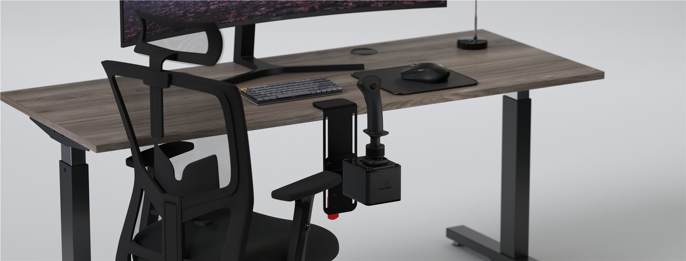
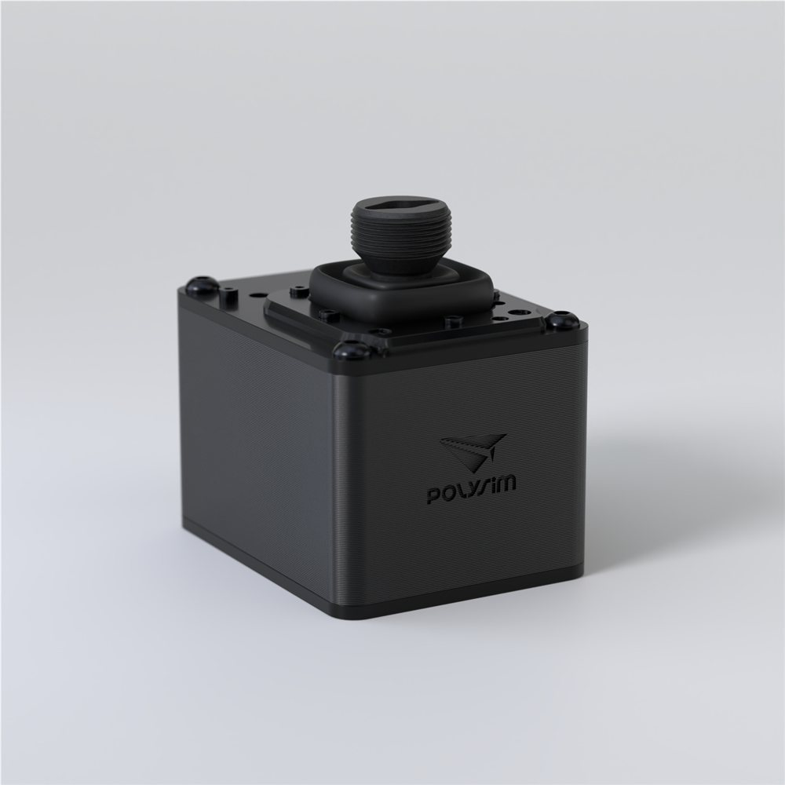
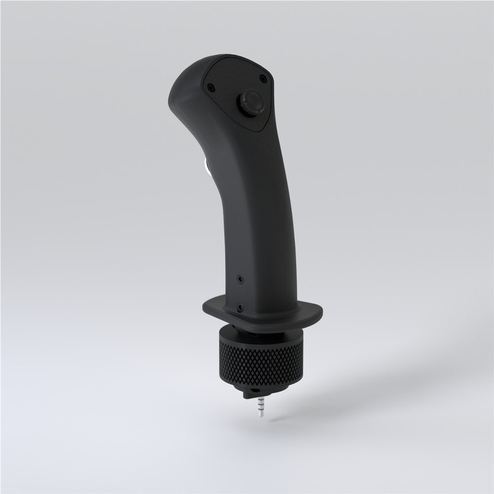
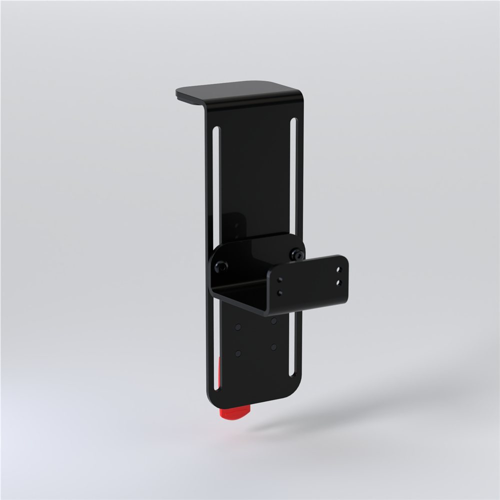

<div align="center">

# Polysim Base

**A metal-framed, 2-axis flight-sim joystick with contactless magnetic sensors, quick-release grips and a desk mount. Every file you need to build it is in this repository.**

[](LICENSE)




[**Build manual**](doc/MANUAL.md) · [Assembly guide (PDF)](doc/Polysim_Base_Assembly_Guide.pdf) · [Grip repository](https://github.com/p0lysim/Polysim_Grip) · [polysim.fr](https://polysim.fr)

</div>

---

## Overview

Polysim is a modular joystick for flight and space simulators, designed end to end: mechanics, electronics, firmware and configuration software. The system has three parts:

| | Module | What it is |
|---|---|---|
|  | **Base** | 2-axis gimbal built from 5 mm laser-cut stainless steel plates, ball bearings and an MJF/SLS main shaft. Cams and springs centre it, felt brakes add adjustable friction, and a moulded silicone boot covers the top. |
|  | **Grip G1 / G2** | Removable handle with an illuminated push button and an analog mini-stick. It locks with a knurled ring and connects through a 4-pole jack. |
|  | **Bracket** | Desk-edge mount made of bent 5 mm steel plates with a toggle clamp and adjustable height. |

## Features

- **Contactless 12-bit magnetic sensors (AS5600).** There are no potentiometer tracks to wear out.
- **Full resolution on the real travel.** The calibrated range is programmed into the sensors, saved in EEPROM and restored at every power-up.
- **Rigid metal gimbal.** Stainless steel plates, ball bearings and an MJF/SLS shaft.
- **Self-centering with adjustable feel.** Cam and spring centering, plus felt friction brakes.
- **Plug and play.** A native USB HID joystick on USB-C, with no driver needed.
- **Quick-release grips.** The grips use an **open I²C protocol**, documented in the manual, so you can design your own.
- **Windows configuration app.** Guided calibration of the base and grip, a live position view and one-click firmware updates.

## Specifications

| | |
|---|---|
| Axes | 2 on the base (roll, pitch) + 2 on the grip mini-stick |
| Sensors | AS5600 magnetic, 12-bit, range scaled to the mechanical travel |
| HID report | X / Y 0–4096 · Rx / Ry 0–1023 · 32 buttons declared (2 used by the standard grip) |
| Controllers | Base: ATmega32U4 (native USB) · Grip: ATmega328P (I²C slave `0x55`) |
| Connections | USB-C to PC · 4-pole jack between grip and base |
| Structure | 5 mm stainless steel plates, MJF/SLS main shaft, FDM-printed housing |
| Software | Windows 10 / 11, 64-bit |

## Repository structure

```text
Polysim_Base/
├── hardware/
│   ├── STL/        3D-printable parts, grouped by assembly step (base, grips G1/G2, SLS parts)
│   ├── DXF/        Cutting files: stainless base plates (laser) and bracket plates (plasma)
│   ├── STEP/       CAD assemblies: base, grips G1/G2, bracket, silicone-boot mould
│   └── 3MF/        Print-ready plates (coming soon)
├── software/
│   ├── installer/  Polysim configuration software (Windows x64 installer)
│   └── firmware/
│       ├── base/   Base firmware: PlatformIO project (ATmega32U4) + prebuilt .hex
│       └── grip/   Grip firmware: Arduino sketch (ATmega328P)
└── doc/
    ├── MANUAL.md                        Complete build and user manual
    ├── Polysim_Base_Assembly_Guide.pdf  Illustrated exploded views, steps 0–9
    └── images/                          Renders, screenshots, print-orientation references
```

## Build overview

> **Skill level: advanced.** You will 3D print, order laser-cut steel and SLS/MJF parts, and program AVR microcontrollers with an ISP programmer.

1. **Gather the parts.** See the [bill of materials](doc/MANUAL.md#3-bill-of-materials).
2. **Manufacture.** Print the FDM parts, order the MJF main shaft and the laser-cut plates, and cast the silicone boot. See [§4](doc/MANUAL.md#4-manufacturing-the-parts).
3. **Program the boards.** Burn the bootloader once over ICSP, then flash the firmware. See [§6](doc/MANUAL.md#6-programming-the-boards).
4. **Assemble.** Follow base steps 0 to 9, then the grip and the bracket. See [§7](doc/MANUAL.md#7-assembly).
5. **Install the software and calibrate.** See [§8](doc/MANUAL.md#8-configuration-software).
6. **Fly.** Bind the axes in your simulator. See [§9](doc/MANUAL.md#9-using-polysim-in-simulators).

**Indicative material cost** at the author's bulk prices (2024–2025): about €111 for the base, €16 for a grip (excluding filament) and €27 for the bracket (excluding the steel plates). A one-off build costs more because of minimum order quantities, shipping and PCB assembly.

## Software and firmware

| Component | Version | Location |
|---|---|---|
| Configuration software (Windows x64) | 0.1 | [`software/installer/Polysim_0_1.exe`](software/installer/) |
| Base firmware (ATmega32U4) | 0.0.4 | [`software/firmware/base/`](software/firmware/base/) · prebuilt: `prebuilt/polysim_base_v0.0.4.hex` |
| Grip firmware (ATmega328P) | — | [`software/firmware/grip/`](software/firmware/grip/) |

Once a base is running, the configuration software can update its firmware over USB from the Polysim update server.

## Electronics

The base uses four custom boards: a base controller with an I²C multiplexer, two magnetic-encoder boards and a grip board. The architecture, wiring and ICSP pinouts are documented in the [manual](doc/MANUAL.md#5-electronics). The PCB fabrication files are not part of this repository.

## Related projects

- [**Polysim_Grip**](https://github.com/p0lysim/Polysim_Grip): CAD files for designing your own Polysim grip.

## Feedback

Bug reports, print feedback, photos of your build and grip designs are welcome. Please [open an issue](https://github.com/p0lysim/Polysim_Base/issues). For a software problem, attach the log file from `%LOCALAPPDATA%\Polysim\Logs\logs.txt`.

## License

The design files, documentation and Polysim firmware are licensed under **[Creative Commons BY-NC-SA 4.0](LICENSE)**. You may build, modify and share them for **non-commercial** purposes, with attribution, as long as you share your changes under the same license.

- **Commercial use** (selling assembled joysticks, kits or parts) requires prior written permission from Polysim.
- The configuration software installer is freeware under its own end-user license, which is shown during installation.
- Third-party components keep their own licenses. See [THIRD_PARTY_NOTICES.md](THIRD_PARTY_NOTICES.md).

## Disclaimer

This is a do-it-yourself project, provided **as is**, without warranty of any kind. You build and use it at your own risk. Read the safety notes in the [manual](doc/MANUAL.md#13-safety-and-disclaimer) before you start.

<div align="center">

© 2024–2026 Polysim

</div>
