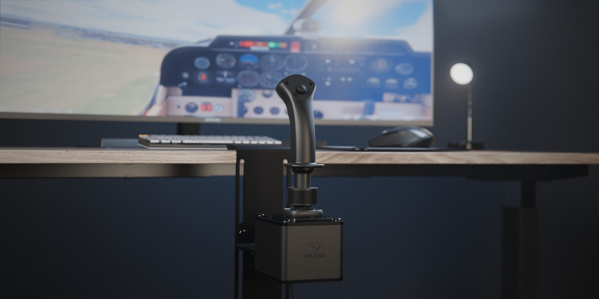

# Polysim Base

**A metal-framed, 2-axis flight-sim joystick with contactless magnetic sensors, quick-release grips and a desk mount. Every file you need to build it is in this repository.**

[**📦 Get the complete kit**](https://polysim.fr) · [**Build manual**](doc/MANUAL.md) · [Assembly guide (PDF)](doc/Polysim_Base_Assembly_Guide.pdf)

---

## Overview

A modular flight-sim joystick in three parts. Build it from the open files, or get the **[complete kit](https://polysim.fr)**.

| | Module | What it is |
|---|---|---|
|  | **Base** | 2-axis gimbal built from 5 mm laser-cut stainless steel plates, ball bearings and an MJF/SLS main shaft. Cams and springs centre it, felt brakes add adjustable friction, and a moulded silicone boot covers the top. **[View in the shop →](https://polysim.fr/products/polysim-base)** |
|  | **Grip G1 / G2** | Removable handle with an illuminated push button and an analog mini-stick. It locks with a knurled ring and connects through a 4-pole jack. **[View in the shop →](https://polysim.fr/products/polysim-grip-3d-printable-kit)** |
|  | **Bracket** | Desk-edge mount made of bent 5 mm steel plates with a toggle clamp and adjustable height. **[View in the shop →](https://polysim.fr/products/poysim-base-support)** |

## Features

| **±20°** | **12-bit** | **5 mm steel** | **0 driver** |
|:---:|:---:|:---:|:---:|
| travel on each axis | contactless sensors | stainless gimbal | native USB HID |

- **Wear-free precision.** AS5600 magnetic sensors spread their full 12-bit resolution over the real travel of the stick.
- **Built to last.** Stainless steel plates, ball bearings and an MJF shaft, with cam and spring centering and adjustable felt brakes.
- **Plug and fly.** Connect it over USB-C and Windows sees a standard joystick. The calibration stays in the base.
- **Swap grips in seconds.** A quick-release jack and an open I²C protocol let you build your own grip.
- **Companion app.** Guided calibration, a live position view and one-click firmware updates.

## Videos

| Quick assembly (Short) | Base assembly — full tutorial | Grip assembly — full tutorial |
|:---:|:---:|:---:|
|  |  |  |

## Build overview

> 📦 **Skip the sourcing.** Print the FDM parts, then get every other component in the **complete kit** on **[polysim.fr](https://polysim.fr)**. Just assemble and fly.

1. **Print and get the kit.** Print the FDM parts, then get the [kit](https://polysim.fr) to assemble your base. The files for all the non-printable parts are also in this repository ([§4](doc/MANUAL.md#4-manufacturing-the-parts)).
2. **Program.** Already done with the electronics kit. Otherwise, flash the bootloader, then the firmware ([§6](doc/MANUAL.md#6-programming-the-boards)).
3. **Assemble.** Base, grip, then bracket ([§7](doc/MANUAL.md#7-assembly)), with video tutorials for the [base](https://www.youtube.com/watch?v=ZJVehHBs4Xg) and the [grip](https://www.youtube.com/watch?v=2aSrMxbHL8U).
4. **Calibrate and fly** ([§8](doc/MANUAL.md#8-configuration-software), [§9](doc/MANUAL.md#9-using-polysim-in-simulators)).

Advanced DIY build. Materials cost about €155 at bulk prices, or you can get all the non-printed parts in one box with the [kit](https://polysim.fr).

## Software and firmware

> ✅ **Electronics kit from [polysim.fr](https://polysim.fr)?** The base and grip boards ship with their firmware already flashed. Just install the configuration software and calibrate.

| Component | Version | Location |
|---|---|---|
| Configuration software (Windows x64) | 0.1 | [`software/installer/Polysim_0_1.exe`](software/installer/) |
| Base firmware (ATmega32U4) | 0.0.4 | [`software/firmware/base/`](software/firmware/base/) |
| Grip firmware (ATmega328P) | — | [`software/firmware/grip/`](software/firmware/grip/) |

Once a base is running, the configuration software can update its firmware over USB from the Polysim update server.

## Related projects

<table>
  <tr>
    <td></td>
    <td><a href="https://github.com/p0lysim/Polysim_Grip"><b>Polysim_Grip</b></a>: CAD files for designing your own Polysim grip.</td>
  </tr>
</table>

## License

The design files, documentation and Polysim firmware are licensed under **[Creative Commons BY-NC-SA 4.0](LICENSE)**. You may build, modify and share them for **non-commercial** purposes, with attribution, as long as you share your changes under the same license.

- **Commercial use** (selling assembled joysticks, kits or parts) requires prior written permission from Polysim.
- The configuration software installer is freeware under its own end-user license, which is shown during installation.
- Third-party components keep their own licenses. See [THIRD_PARTY_NOTICES.md](THIRD_PARTY_NOTICES.md).

## Disclaimer

This is a do-it-yourself project, provided **as is**, without warranty of any kind. You build and use it at your own risk. Read the safety notes in the [manual](doc/MANUAL.md#13-safety-and-disclaimer) before you start.

**Complete kits available on [polysim.fr](https://polysim.fr)**

© 2024–2026 Polysim

