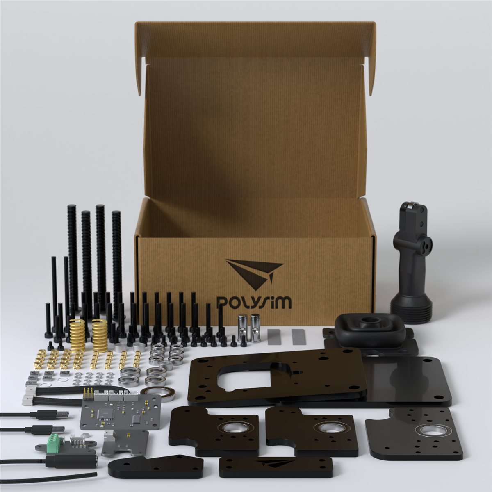
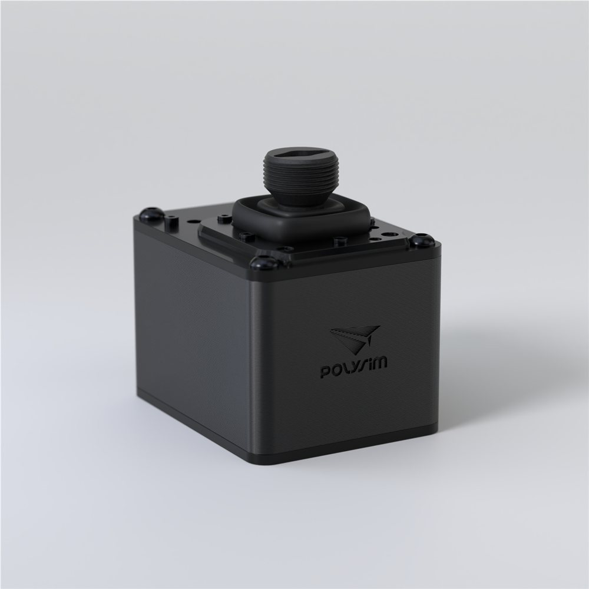
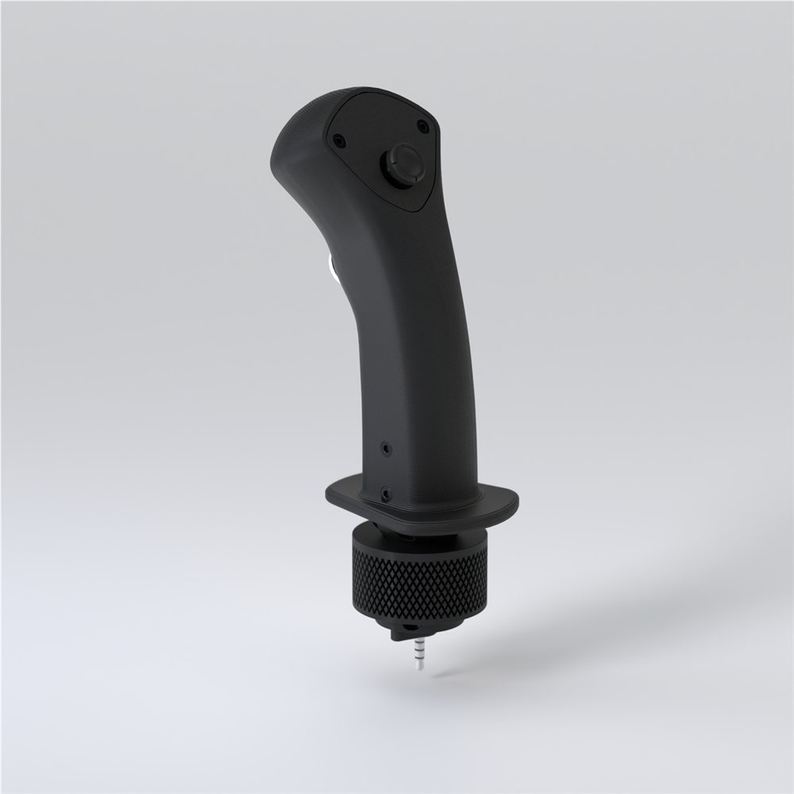
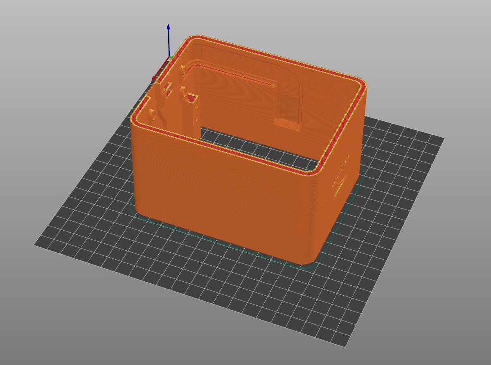
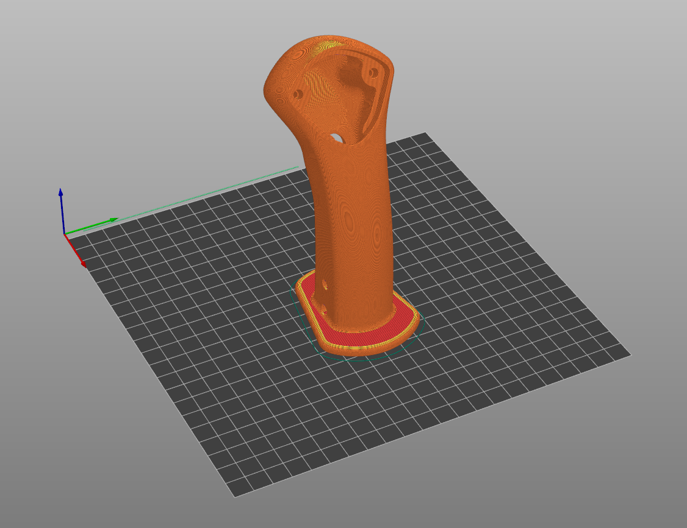
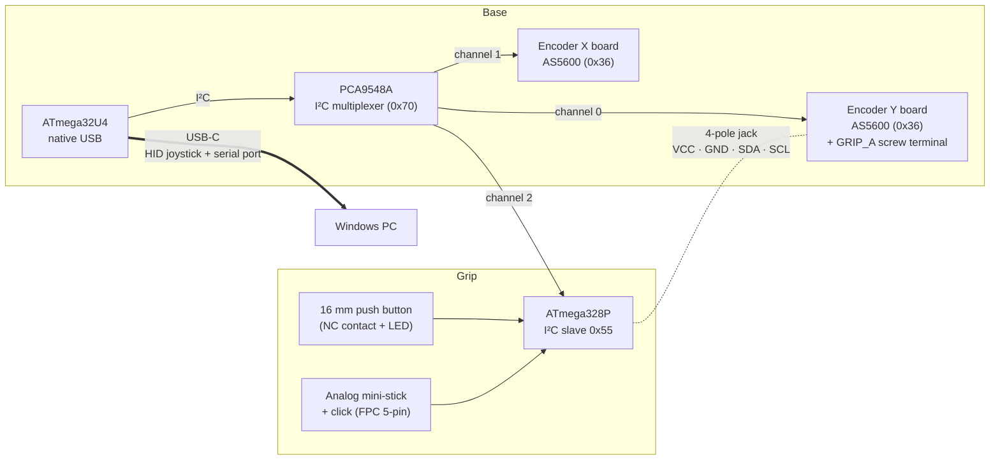
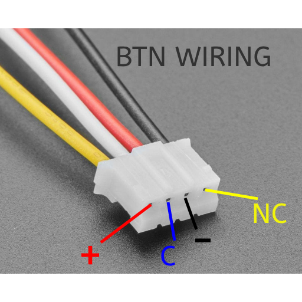
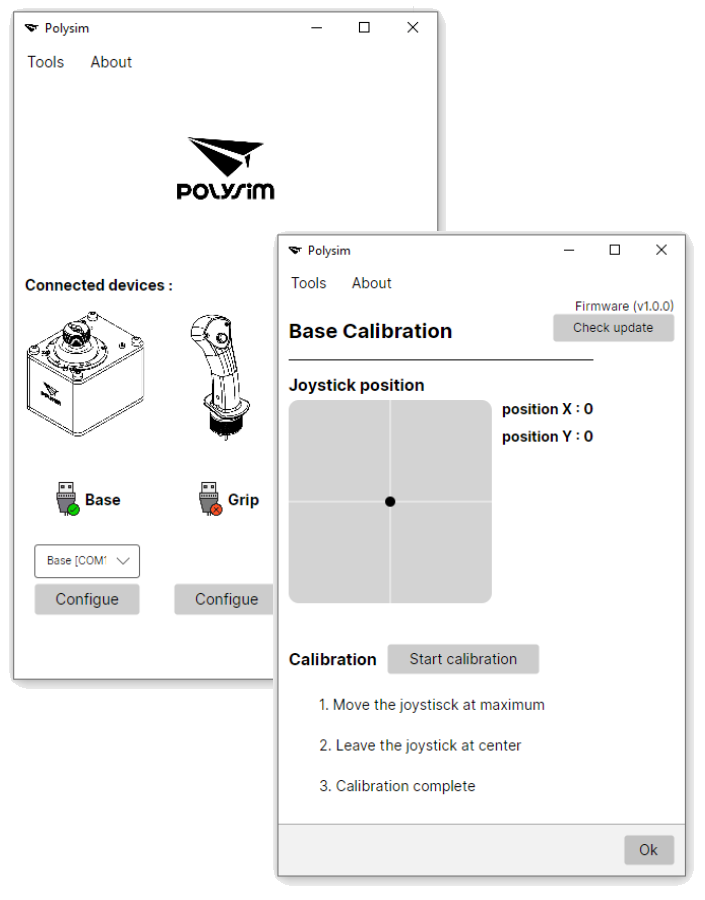

# Polysim Base — Build & User Manual

> **Manual version 1.0 — November 2026**
> Covers firmware **0.0.4** (base), the grip firmware, and configuration software **0.1** (Windows x64).



This manual explains how to manufacture, program, assemble, calibrate and use the **Polysim Base** joystick (metal version), its **G1/G2 grips** and its **desk bracket**. It also documents the technical interfaces (USB, I²C, serial protocol) for people who want to modify the firmware or design their own grip.

The illustrated exploded views for the base are in [Polysim_Base_Assembly_Guide.pdf](Polysim_Base_Assembly_Guide.pdf). This manual refers to them as *PDF step 0* to *PDF step 9*.

---

## Contents

1. [Overview](#1-overview)
2. [Tools and skills](#2-tools-and-skills)
3. [Bill of materials](#3-bill-of-materials)
4. [Manufacturing the parts](#4-manufacturing-the-parts)
5. [Electronics](#5-electronics)
6. [Programming the boards](#6-programming-the-boards)
7. [Assembly](#7-assembly)
8. [Configuration software](#8-configuration-software)
9. [Using Polysim in simulators](#9-using-polysim-in-simulators)
10. [Troubleshooting](#10-troubleshooting)
11. [Known issues and limitations](#11-known-issues-and-limitations)
12. [Technical reference](#12-technical-reference)
13. [License and credits](#13-license-and-credits)

---

## 1. Overview

### 1.1 The modules

| Module | Description | Files |
|---|---|---|
| **Base** | 2-axis gimbal. 5 mm laser-cut stainless steel plates, ball bearings, MJF/SLS main shaft, cam and spring centering, felt friction brakes, moulded silicone boot. Two AS5600 magnetic sensors, ATmega32U4 controller, USB-C. | `hardware/STEP/Base.step`, `hardware/STL/Base/`, `hardware/DXF/Base plates/` |
| **Grip G1 / G2** | Removable handle with a 16 mm illuminated push button and an analog mini-stick with click. Contains an ATmega328P that talks to the base over I²C. Connects through a 4-pole jack with a knurled locking ring. G1 and G2 are two body shapes. | `hardware/STEP/Grip G1.step`, `Grip G2.step`, `hardware/STL/Grip G1/`, `Grip G2/` |
| **Bracket** | Desk mount made of two 5 mm steel plates and a toggle clamp. It hangs on the edge of the desk, and its slots make the height adjustable. | `hardware/STEP/Bracket.step`, `hardware/DXF/Bracket/` |

| Base | Grip | Bracket |
|---|---|---|
|  |  |  |

### 1.2 How it works

The base enumerates on the PC as a **standard USB HID joystick** named *Polysim Base*. No driver is needed. On the same USB cable it also exposes a **virtual serial port**, which only the Polysim configuration software uses (calibration, version check, firmware update).

Each gimbal axis carries a diametrically magnetised magnet facing an **AS5600** 12-bit magnetic sensor. During calibration the measured travel is programmed into the sensor's ZPOS/MPOS registers, so the full 0–4095 resolution covers the real travel of the stick. The calibration is stored in the controller's EEPROM and written back to the sensors at every power-up.

The grip is an **I²C slave** (address `0x55`). The base polls it continuously through an I²C multiplexer, which is also what lets two AS5600 sensors share their fixed address (`0x36`).

### 1.3 Safety and disclaimer

- This is a do-it-yourself project. You build and use it at your own risk; the files are provided without warranty.
- Laser-cut and plasma-cut steel parts can have sharp edges. Deburr them before handling and assembly.
- Heat-set inserts are installed with a soldering iron. Work in a ventilated area and keep the iron on a stand.
- Compressed springs store energy. Keep fingers clear while you assemble the centering mechanism.
- Always unplug the USB cable before you connect or disconnect the grip, or before you work on the electronics.

---

## 2. Tools and skills

**Skill level: advanced.** You will need to 3D print, order cut metal and SLS/MJF parts from suppliers, handle small electronics, and program AVR microcontrollers with an ISP programmer.

| Category | Items |
|---|---|
| Hand tools | Hex keys 2.5 mm, 3 mm and 5 mm (for the DIN 912 / ISO 7380 screws), small flat screwdriver (screw terminal), pliers or circlip pliers, deburring tool or file |
| 3D printing | FDM printer (PETG recommended for structural parts), soldering iron with an insert tip for heat-set inserts |
| Electronics | ISP programmer (USBasp, or an Arduino Uno flashed as *Arduino as ISP*) with a 6-pin ISP cable, USB-C data cable, multimeter (recommended) |
| Silicone boot | Two-part casting silicone, mixing cups, the printed mould |
| Software | Windows 10/11 x64; [Arduino IDE 2.x](https://www.arduino.cc/en/software) and/or [VS Code + PlatformIO](https://platformio.org/) |

---

## 3. Bill of materials

> 📦 **Don't want to source the parts yourself?** Print the FDM parts and get all the other components below as a **complete kit** on [polysim.fr](https://polysim.fr).

### 3.1 Manufactured parts

| Part | Qty | Process | Source file |
|---|---|---|---|
| Base plates (left and right side plates, 2× cam plate, large, small, top, bottom and dummy plates) | 9 | Laser cutting, **5 mm stainless steel** | `hardware/DXF/Base plates/LASER - Export INOX 5mm.dxf` |
| Main shaft (grip mount) | 1 | **MJF / SLS** (PA12) | `hardware/STL/SLS printing for extra strength/SLS_3DPrint - main axis  -0.2mm + 0.1mm mjf.stl` |
| Support (PDF step 0) | 1 | SLS / MJF | `hardware/STL/Base/Others/SLS/fixation_pics.stl` |
| Grip top plate | 1 per grip | SLS / MJF (recommended) or FDM | `hardware/STL/SLS printing for extra strength/plate grip.stl` (FDM version: `Grip G1/plate.stl`) |
| Base printed parts (housing, supports, brakes, spacers, covers…) | see §4.1 | FDM | `hardware/STL/Base/STEP_1` … `STEP_9` |
| Grip printed parts (body, linker, junction, PCB spacer) | see §4.1 | FDM | `hardware/STL/Grip G1/` or `Grip G2/` |
| Silicone boot | 1 | Cast silicone (≈ 30 g) in a printed mould | Mould: `hardware/STEP/Solicon_mold.step` · boot shape: `hardware/STL/Base/Others/Silicon/rubber.stl` |
| Bracket plates P1 and P2 | 2 | Plasma or laser cutting, **5 mm steel**, then bending | `hardware/DXF/Bracket/PLASMA Export dxf P1 5mm.dxf`, `P2` |
| Steel tube Ø10 mm and steel rod Ø8 mm | 2 + 2 | Cut to length (take the lengths from `Base.step`) | — |
| Electronic boards: base controller, encoder X, encoder Y, grip | 4 | PCB with SMT assembly | Not included in this repository (see §5) |

### 3.2 Base hardware

These totals are summed from the per-step lists of the assembly guide (PDF steps 0–9). Screws are DIN 912 socket head cap screws, A2 stainless, unless noted. The visible top-cover and boot screws are black steel (12.9) in the original build. Fasteners are cheap and usually sold in packs of 50–200, so buy a few spares.

| Item | Qty |
|---|---|
| M3×4 | 2 |
| M3×8 | 11 |
| M3×10 | 1 |
| M3×14 | 8 |
| M4×6 (or M4×8), black | 5 |
| M4×10 | 3 |
| M4×12 | 1 |
| M4×18 (two of them may be M4×20) | 3 |
| M4×25 (black for the top cover) | 12 |
| M4×30 | 11 |
| M4×60 | 2 |
| M8×90 button head screw (ISO 7380, class 10.9) | 4 |
| Heat-set insert M3 (Ruthex M3 "short", 4 mm) | 13 |
| Heat-set insert M4 (Ruthex M4 "short", 4 mm) | 4 |
| Square nut M3 | 1 |
| Square nut M4 (7×7×2.2 mm) | 6 |
| Barrel nut M4 | 2 |
| Nylon washer M3 | 11 |
| Nylon washer M4 | 4 |
| Shaft retaining ring Ø8 mm (2 used as circlips in PDF step 1, 2 as brake rings in PDF steps 3–4) | 4 |
| Ball bearing 604ZZ (4×12×4 mm) | 6 |
| Ball bearing 685-2RS (5×11×5 mm) | 2 |
| Ball bearing 688ZZ, thin (8×16×4 mm) | 4 |
| Ball bearing 61803-2RS (17×26×5 mm) | 3 |
| Compression spring, Ø12 mm outer diameter (yellow die-spring type) | 2 |
| Felt pad (brakes) | 2 |
| Neodymium disc magnet **5×2 mm, diametrically magnetised** | 2 |
| 4-pole jack socket, female (grip connector) | 1 |
| JST PH 4-pin cable (encoder cables) | 3 |
| USB-C to USB-A data cable, 2 m | 1 |

> The original purchasing spreadsheet lists slightly different quantities for a few items (for example four 61803 bearings). If a count looks wrong during assembly, check `Base.step`.

### 3.3 Grip hardware (per grip)

| Item | Qty |
|---|---|
| M1.6×4 | 2 |
| M3×6 | 4 |
| M3×8 | 2 |
| M3×10 (PCB mounting) | 2 |
| M3×20 | 4 |
| Heat-set insert M3 (short) | 12 |
| Nylon washer M3 | 2 |
| 16 mm round momentary push button with LED (NO/NC contacts) | 1 |
| Analog mini-stick, console-controller type, 5-pin FPC (0.5 mm pitch) | 1 |
| 4-pole jack plug, male | 1 |
| JST PH 4-pin cable | 1 |
| Grip PCB | 1 |

### 3.4 Bracket hardware

| Item | Qty |
|---|---|
| Toggle clamp (Bessey STC-IHH25 or equivalent) | 1 |
| M6×8, black | 4 |
| M6×12, black (14 mm maximum) | 2 |
| Bracket plates P1 and P2 | 2 |

### 3.5 Indicative material cost

At the author's 2024–2025 bulk purchase prices, the material cost was about **€111 for the base** (including the stainless plates, SLS shaft, bearings and electronic components), **€16 for a grip** (excluding filament) and **€27 for the bracket** (mostly the toggle clamp, excluding the steel plates). A one-off build costs more because of minimum order quantities, shipping and PCB assembly fees.

---

## 4. Manufacturing the parts

### 4.1 FDM printed parts

The STL files are grouped by assembly stage in `hardware/STL/Base/STEP_1` … `STEP_9`. If you are unsure where a part goes, open `hardware/STEP/Base.step` in any CAD viewer.

| Folder | Files |
|---|---|
| `Base/STEP_1` | `support roullement.stl` |
| `Base/STEP_2` | `CAM_V5.stl` |
| `Base/STEP_3` | `petit support.stl`, `support_av (1) (1) (1).stl`, `support_av (1) (1) (2) (2).stl` |
| `Base/STEP_4` | `frein.stl`, `freinX (1).stl`, `rondelle freinX.stl`, `support_vis_frein.stl` |
| `Base/STEP_5` | `Body10.stl`, `Body_X_Oppose.stl`, `frein V1.stl` |
| `Base/STEP_6` | `Left_body (1).stl`, `right_body.stl` |
| `Base/STEP_7` | `spacer_X.stl`, `spacer_Y.stl` |
| `Base/STEP_8` | `Body_3D_print.stl` (electronics housing), `Passe_cable_languette (2).stl` (cable guide) |
| `Base/STEP_9` | `Plaque cache soufflet.stl` (boot cover plate) |
| `Base/Others/Tools` | `V2.stl` (assembly tool) |
| `Base/Others/Plates` | STL versions of the metal plates, for reference and test fitting. The real plates are 5 mm stainless steel. |
| `Grip G1/` | `grip_single!piece.stl` (body), `Export_linder_V2_1P.stl` (linker), `jonction_V2.stl` (junction), `plate.stl` (top plate), `Spacer one piece.stl` (PCB spacer) |
| `Grip G2/` | `Body1.stl` (body), plus the same linker, junction, plate and spacer as G1 |
| `assembly/` | `Base_main.stl`, `Grip G1.stl`: complete assemblies for visualisation only. Do not print them. |

**Print orientation.** Slicer screenshots showing the intended orientation of each part are in [images/print_orientation/](images/print_orientation/) (`base/`, `grip_g1/`, `grip_g2/`). For example:

| Electronics housing | Grip body |
|---|---|
|  |  |

**Suggested settings.** These are a starting point, not a validated profile; adjust them to your printer and filament.

| Setting | Structural parts (base) | Grip body |
|---|---|---|
| Material | PETG (or ASA / ABS) | PETG or PLA |
| Layer height | 0.2 mm | 0.16–0.2 mm |
| Walls | 4 | 3 |
| Infill | 40 % (gyroid or cubic) | 20 % |
| Supports | Only where the orientation images show overhangs | Tree supports for the internal cavities, as needed |

**Heat-set inserts.** Install all inserts before assembly with a soldering iron at the temperature recommended by the insert maker. Press them in straight and flush. The base uses 13 M3 and 4 M4 inserts; each grip uses 12 M3 inserts.

### 4.2 SLS / MJF parts

The **main shaft** carries the grip and transmits all the loads into the gimbal, so it must be made by **MJF or SLS (PA12)**, not FDM.

- `SLS_3DPrint - main axis  -0.2mm + 0.1mm mjf.stl` has been compensated (−0.2 mm / +0.1 mm) for HP Multi Jet Fusion. Use it with an MJF service.
- `Base/Others/SLS/main_axis.stl` is the nominal geometry.
- `Base/Others/SLS/fixation_pics.stl` is the support of PDF step 0.
- `plate grip.stl` is the grip top plate. SLS is recommended for strength.

The original parts were ordered from Sculpteo; any SLS/MJF service works.

### 4.3 Laser-cut stainless plates

`hardware/DXF/Base plates/LASER - Export INOX 5mm.dxf` contains the nine base plates. Order them in **5 mm stainless steel** from a laser-cutting service, and deburr all edges. A black finish (as in the renders) is optional.

### 4.4 Bracket plates

`hardware/DXF/Bracket/` contains the two bracket plates (`P1`, `P2`) in **5 mm steel** for plasma or laser cutting. Both plates are **bent** after cutting. The PNG previews show the bend lines and dimensions, and `hardware/STEP/Bracket.step` shows the final shape. Many cutting services can also do the bending.

### 4.5 Silicone boot

1. Print the mould from `hardware/STEP/Solicon_mold.step`. The original mould was printed in TPU, which makes demoulding easier.
2. Mix about **30 g** of two-part casting silicone, pour it into the mould and let it cure as the manufacturer specifies.
3. Demould and trim the boot. `rubber.stl` is the target boot shape, for reference.

### 4.6 Electronic boards

The base needs four custom boards: the base controller, two magnetic encoder boards (X and Y) and the grip board. Their functions and connections are described in §5. **The PCB fabrication files (Gerber, component BOM, placement) are not included in this repository.**

---

## 5. Electronics

### 5.1 Architecture



### 5.2 The boards

| Board | Main parts | Connectors |
|---|---|---|
| **Base controller** | ATmega32U4 (16 MHz crystal), PCA9548A I²C multiplexer, USB-C, 500 mA resettable fuse, reset button, status LEDs | `ENC_X`, `ENC_Y`, `GRIP_B` (JST PH 4-pin), ICSP 2×3 header |
| **Encoder X** | AS5600 magnetic sensor, I²C pull-ups | 1 × JST PH 4-pin |
| **Encoder Y** | AS5600 magnetic sensor, I²C pull-ups | 2 × JST PH 4-pin (pass-through of the grip bus) and a 4-way screw terminal `GRIP_A` for the jack wires |
| **Grip** | ATmega328P (16 MHz crystal), MT3608 boost converter, reset button, LEDs | FPC 5-pin 0.5 mm (mini-stick), `GRIP_A` and `BTN` (JST PH 4-pin), ICSP 2×3 header |

### 5.3 Wiring

Every 4-wire link carries **VCC (5 V), GND, SDA, SCL**. Always match the labels printed on the boards.

| From | To | Cable |
|---|---|---|
| Base controller `ENC_X` | Encoder X board | JST PH 4-pin |
| Base controller `ENC_Y` | Encoder Y board | JST PH 4-pin |
| Encoder Y board (second JST) | Base controller `GRIP_B` | JST PH 4-pin |
| Female jack in the base | Encoder Y board `GRIP_A` screw terminal | 4 wires |
| Grip board `GRIP_A` | Male jack in the grip | JST PH 4-pin to jack |
| Push button | Grip board `BTN` | JST PH 4-pin |
| Mini-stick | Grip board FPC connector | FPC ribbon |
| Base controller USB-C | PC | USB-C to USB-A, 2 m |

**Push button wiring.** The 16 mm button has four connections: **+** (LED +), **C** (common), **−** (LED −) and **NC** (normally closed contact).



**Magnets.** Glue one 5×2 mm diametrically magnetised magnet, centred, at the end of each gimbal axle (PDF steps 0 and 3). Each encoder board is screwed facing its magnet (PDF step 6). A magnet that is off-centre or too far from the AS5600 gives noisy or non-linear readings.

> **Note.** The grip I²C bus runs through a jack and a cable, so it is sensitive to cable length and interference. The firmware uses a 3 ms I²C timeout with automatic bus reset, so an unplugged grip does not freeze the base. Even so, **unplug the USB cable before you connect or disconnect the grip.**

---

## 6. Programming the boards

> ✅ **Electronics kit from [polysim.fr](https://polysim.fr)?** The base and grip boards are delivered with their firmware already flashed. Skip this section and go to [§7](#7-assembly).

A blank ATmega32U4 or ATmega328P does **not** contain a bootloader. Each board must be programmed **once** through its ICSP header with an ISP programmer. After that, the base can be updated over USB.

### 6.1 ICSP pinout

Both boards use the standard 6-pin AVR ISP pinout. **Pin 1 (MISO) is the square pad.**

| Pin | Signal | Pin | Signal |
|---|---|---|---|
| 1 (square) | MISO | 2 | VCC |
| 3 | SCK | 4 | MOSI |
| 5 | RST | 6 | GND |

On the base board, the header sits next to the screw terminal: VCC / MOSI / GND on one row and MISO / SCK / RST on the other.

### 6.2 Base board (ATmega32U4)

**Step 1: burn the bootloader (once).**

1. In the Arduino IDE, select **Tools → Board → Arduino AVR Boards → Arduino Micro**.
2. Select your programmer (**USBasp** or **Arduino as ISP**) under **Tools → Programmer**.
3. Connect the programmer to the base ICSP header (§6.1).
4. Run **Tools → Burn Bootloader**.

This writes the Caterina bootloader and the fuses that the Polysim firmware expects (`lfuse 0xFF`, `hfuse 0xD8`, `efuse 0xCB`). You can also use PlatformIO's `bootloader` target with an ISP `upload_protocol` set in `platformio.ini`.

**Step 2: flash the firmware over USB.** Connect the base with a USB-C data cable, then use one of these options.

- **Option A, PlatformIO (from source).** Open `software/firmware/base/` in VS Code with PlatformIO and run **Upload**, or `pio run -t upload` from the command line.
- **Option B, prebuilt hex with avrdude.** Put the board in bootloader mode by pressing the reset button (SW1); press it twice quickly if the port does not appear. The bootloader stays active for about 8 seconds and shows up as a new COM port. Then run:

  ```bash
  avrdude -p atmega32u4 -c avr109 -P COM5 -b 57600 -D -U flash:w:polysim_base_v0.0.4.hex:i
  ```

  Replace `COM5` with the bootloader port. `avrdude` ships with the Arduino IDE and with PlatformIO. The hex is in `software/firmware/base/prebuilt/`.

**Step 3: check.** Open the Windows game controller panel (`Win + R`, then `joy.cpl`). **Polysim Base** should be listed. Later updates can be done from the configuration software (§8.6).

### 6.3 Grip board (ATmega328P)

The grip board has no USB port. It is programmed only through ICSP.

1. Open `software/firmware/grip/polysim_grip/polysim_grip.ino` in the Arduino IDE.
2. Select **Tools → Board → Arduino Nano**, **Processor → ATmega328P**, and your programmer.
3. Connect the programmer to the grip ICSP header (§6.1).
4. Run **Tools → Burn Bootloader** once. This sets the fuses for the external 16 MHz crystal.
5. Run **Sketch → Upload Using Programmer**.

The grip firmware only needs the standard `Wire` library.

---

## 7. Assembly

### 7.1 General advice

- Install every heat-set insert before you start (§4.1).
- Do not over-tighten screws that go into plastic or inserts. Snug is enough.
- Check that each axis turns freely after every step. A tight bearing seat or a misaligned plate is much easier to fix early.
- Sort the hardware by step before you start. The lists below match the illustrated PDF.

### 7.2 Base

> 🎬 **Video tutorial:** [Flight sim base — assembly tutorial](https://www.youtube.com/watch?v=ZJVehHBs4Xg) (full assembly, step by step) · [Quick assembly (Short)](https://www.youtube.com/shorts/dEi8qn8T1VA)

Follow [Polysim_Base_Assembly_Guide.pdf](Polysim_Base_Assembly_Guide.pdf). PDF step *n* is on page *n + 1*. The parts needed for each step:

| PDF step | What happens | Parts |
|---|---|---|
| **0** | Prepare the main shaft | MJF main shaft ×1, jack socket ×1, magnet ×1, M3 insert ×2, support ×1, M3×10 ×1, M4 square nut ×1, M3×14 ×2, 5×11 bearing ×1 |
| **1** | Cams | Cam ×2, M3 insert ×4, M4 barrel nut ×2, M3×14 ×4, circlip ×2, 4×12 bearing ×4, 8×16 bearing ×4 |
| **2** | Side plates and Y-axis bearings | Left and right plates ×2, 17×26 bearing ×2, M4×30 ×6, M3 square nut ×1, M4 square nut ×1, 5×11 bearing ×1, M4 nylon washer ×2, M3 insert ×1, M3×14 ×2 |
| **3** | First spring, brake and magnet | Spring ×1, M4×25 ×2, M4×60 ×1, M4×10 ×3, M3 insert ×1, M4 insert ×1, M3×4 ×1, felt ×1, magnet ×1, retaining ring ×1, 4×12 bearing ×1 |
| **4** | Second brake | 17×26 bearing ×1, 4×12 bearing ×1, retaining ring ×1, M4 square nut ×2, M4 insert ×2, M3 insert ×1, felt ×1, M4×18 ×1, M4×12 ×1, M4×25 ×1, M3×4 ×1 |
| **5** | Second spring, large and small plates | Spring ×1, large plate ×1, small plate ×1, M4×60 ×1, M4×25 ×3, M4×30 ×5, M4 nylon washer ×2, M4 square nut ×2, M4 insert ×1 |
| **6** | Encoder boards | Encoder X board ×1, encoder Y board ×1, encoder Y cable ×1, M3×8 ×7, M3 nylon washer ×7 |
| **7** | Base board in the housing | Base board ×1, M3×8 ×4, M3 nylon washer ×4, M3 insert ×4 |
| **8** | Encoder cables | Base ↔ encoder cables ×2 (see §5.3) |
| **9** | Closing | Bottom plate ×1, top plate ×1, dummy plate ×1, silicone boot ×1, M8×90 ×4, M4×25 ×6, M4×20 (or M4×18) ×2, M4×6 (or M4×8) ×5 |

Before you close the base in step 9, connect the female jack wires to the `GRIP_A` terminal of the encoder Y board (§5.3).

### 7.3 Grip

> 🎬 **Video tutorial:** [Flight sim grip G1 — assembly tutorial](https://www.youtube.com/watch?v=2aSrMxbHL8U)

Use `hardware/STEP/Grip G1.step` (or `Grip G2.step`) as the reference for part placement.

1. Install the 12 M3 inserts in the printed parts.
2. Program the grip board (§6.3).
3. Wire the push button to the `BTN` connector (§5.3) and the mini-stick to the FPC connector.
4. Mount the board on the PCB spacer (2 × M3×10), then install the spacer in the body.
5. Fit the push button and the mini-stick in the top plate, then close the top of the grip.
6. Mount the junction and the linker that carry the **male jack**, and connect the jack to the board's `GRIP_A` connector.
7. With the USB cable unplugged, insert the grip into the base and tighten the knurled ring.

### 7.4 Bracket

1. Have plates P1 and P2 cut and bent (§4.4).
2. Mount the toggle clamp and assemble the two plates with the M6 screws. See `hardware/STEP/Bracket.step`.
3. Hook the bracket on the edge of the desk, lock it with the toggle clamp, then fix the base to it at the height you want using the slots.

### 7.5 Tuning

- **Centering force** comes from the two compression springs pushing on the cams. Stiffer or longer springs give a firmer return to centre.
- **Friction / damping** comes from the felt pads in the two brake assemblies (PDF steps 3 and 4). Start with the brake screws loose and tighten them gradually. Check that the stick still returns to centre on its own.
- **Recalibrate** (§8.4) after any mechanical change.

---

## 8. Configuration software



### 8.1 Requirements

- Windows 10 or 11, 64-bit. No separate .NET installation is needed.
- An Internet connection is optional. It is used to check for software and firmware updates.

### 8.2 Installation

1. Run `software/installer/Polysim_0_1.exe`.
2. The installer is not code-signed, so Windows SmartScreen may warn you. Click **More info → Run anyway** if you trust the source.
3. Accept the license and finish the installation.

### 8.3 Main screen

The main screen shows one tile per module with a USB status icon: **green** means detected, **red** means not detected. If several bases are connected, pick one from the drop-down list. Click **Configure** (spelled *Configue* in version 0.1) under a module to open its calibration screen.

- **Tools → Open windows calibration** opens the Windows game controller panel (`joy.cpl`).
- The **Throttle** tile is a placeholder; the throttle module is not available yet.

### 8.4 Calibrate the base

1. Click **Configure** under **Base**.
2. Click **Start calibration**.
3. **Step 1 (12 s):** move the stick slowly to **all its extremes**, including the corners, several times.
4. **Step 2 (6 s):** **let go of the stick** so it rests at its natural centre. Do not touch it.
5. **Step 3:** the calibration is written to the sensors and saved in the base EEPROM. It is restored automatically at every power-up.

The live position square should now cover the whole travel, with the dot centred at rest. Recalibrate after any mechanical change (springs, brakes, magnets).

### 8.5 Calibrate the grip

Open **Configure** under **Grip** and run the same three steps with the **mini-stick**.

> **Important.** After calibrating the grip, **unplug and replug the base's USB cable** to apply the new calibration (see §11). The grip calibration is stored in the **base**, so it stays with the base when you swap grips.

### 8.6 Firmware update

In the base calibration screen, the current firmware version is shown next to **Check update**. Click it. If a newer version is available on the Polysim update server, confirm, and the software downloads and flashes it. **Do not unplug the base during the update.**

### 8.7 Logs

The software writes a log to `%LOCALAPPDATA%\Polysim\Logs\logs.txt`. Include it with any bug report.

---

## 9. Using Polysim in simulators

The base is a standard DirectInput / HID joystick, so any simulator that supports game controllers detects it as **Polysim Base**.

| HID control | Source | Range |
|---|---|---|
| X axis | Base, roll | 0–4096 |
| Y axis | Base, pitch | 0–4096 |
| Rx axis | Grip mini-stick, horizontal | 0–1023 |
| Ry axis | Grip mini-stick, vertical | 0–1023 |
| Button 1 | Grip push button | on/off |
| Button 2 | Mini-stick click | on/off |

- Bind the axes and buttons in your simulator's control settings. If an axis moves the wrong way, use the simulator's **invert** option.
- Response curves and dead zones are set in the simulator. The Polysim software does not provide them.
- The HID descriptor declares 32 buttons, so richer grips can be added later without changing the PC side.

---

## 10. Troubleshooting

| Symptom | Likely cause | What to do |
|---|---|---|
| Nothing appears in `joy.cpl` | Charge-only USB cable, firmware not flashed, or a power problem | Use a USB data cable. If the board shows up as *Arduino Micro*, only the bootloader is present: flash the firmware (§6.2). |
| The software shows the base in red | The software only looks for the Polysim USB identity | Check that `joy.cpl` lists *Polysim Base*. Close other programs that may hold the COM port (serial monitors, PlatformIO). |
| The grip is shown in red | Jack not fully inserted, wiring error on `GRIP_A`, or grip not programmed | Unplug the USB cable, reseat the grip and tighten the ring. Check the VCC / GND / SDA / SCL order on both sides. Reprogram the grip (§6.3). |
| An axis does not move or jumps | Magnet missing, off-centre or too far from the sensor; encoder cable on the wrong connector | Check the magnet and encoder board mounting (PDF steps 0, 3 and 6) and the `ENC_X` / `ENC_Y` cables. Recalibrate. |
| The axis range is too small or off-centre | Calibration missing or outdated | Recalibrate (§8.4). Move to every corner in step 1 and let go in step 2. |
| A new grip calibration has no effect | Known firmware issue | Unplug and replug the base (§11). |
| The software is very slow to start | No Internet, or the update server does not respond | Wait (up to about 100 s) or connect to the Internet (§11). |
| The firmware update failed and the base no longer responds | Interrupted download or flash | Reflash over USB with the bootloader (§6.2, option A or B). If the bootloader is damaged, burn it again by ISP. |
| An axis is inverted in game | Different axis convention in the simulator | Invert the axis in the simulator. |

---

## 11. Known issues and limitations

| Issue | Impact | Workaround |
|---|---|---|
| Grip calibration is only applied after the base restarts | A new grip calibration seems to have no effect | Unplug and replug the base |
| The update check at start-up can block the software when the server does not answer | Start-up can take up to about 100 s without Internet | Wait, or connect to the Internet |
| No integrity check on downloaded firmware | A corrupted download can fail to flash | Reflash manually (§6.2) |
| Throttle tile shown but not supported | None | — |
| Windows only | No configuration software on Linux or macOS. As a standard USB HID joystick, the base should also work on other systems (not tested) | Calibrate on a Windows PC; the calibration is stored in the base |
| Minor typos in the user interface | Cosmetic | — |
| The standard grip has 2 buttons and 2 axes | Fewer controls than commercial grips | Design your own grip (§12.3) |

---

## 12. Technical reference

### 12.1 USB identity

| Field | Value |
|---|---|
| Product name | `Polysim Base` |
| Application VID / PID | `0x2342` / `0x803F` |
| Bootloader | Caterina (Arduino Micro), `avr109` protocol, 57600 baud, reset by a 1200-baud "touch" |
| MCU / clock | ATmega32U4, 16 MHz |
| Maximum firmware size | 28 672 bytes |

These values are in `software/firmware/base/boards/polysim_base.json`. The configuration software identifies a base by its VID/PID. If you distribute a modified firmware, use your own USB VID/PID and update the software accordingly.

### 12.2 I²C bus

| Multiplexer channel (PCA9548A @ `0x70`) | Device | Address |
|---|---|---|
| 0 | AS5600, Y axis | `0x36` |
| 1 | AS5600, X axis | `0x36` |
| 2 | Grip | `0x55` |

The AS5600 registers used are ZPOS (`0x01`), MPOS (`0x03`), RAW ANGLE (`0x0C`, during calibration) and ANGLE (`0x0E`, in use). The OTP *burn* command is **not** used: the AS5600 allows only three burns, so the calibration lives in the ATmega32U4 EEPROM and is rewritten to the sensor at boot.

### 12.3 Grip protocol (build your own grip)

A grip is any I²C slave at address **`0x55`** that implements these registers. The base writes the register number, then reads 1 or 2 bytes.

| Register | Content | Size |
|---|---|---|
| `0x01` | Main button: analog reading truncated to 8 bits. The base reads **pressed if > 100**, which suits a normally-closed contact with pull-up. | 1 byte |
| `0x02` | Stick click: analog reading truncated to 8 bits. The base reads **pressed if < 100**, which suits a normally-open contact with pull-up. | 1 byte |
| `0x03` | Mini-stick X, 0–1023 | 2 bytes, big-endian |
| `0x04` | Mini-stick Y, 0–1023 | 2 bytes, big-endian |

Grip connector: 4-pole jack carrying VCC (5 V), GND, SDA and SCL. The reference implementation is `software/firmware/grip/polysim_grip/polysim_grip.ino`. It uses pins A0 (button), A1 (click), A2/A3 (stick axes) and A4/A5 (SDA/SCL), and drives an LED on D2. To use more buttons, add registers on the grip and read them in `software/firmware/base/src/Grip.cpp`.

### 12.4 Serial protocol (base ⇄ software)

ASCII commands over the USB virtual serial port, terminated by `\n`:

```text
<P> <CMD> <VALUE>\n        P = J (base) or G (grip), CMD = 2 characters, VALUE = integer (0 if unused)
ACK <P> <CMD> <VALUE> <RESULT>\n
```

Example: `J VE 0` → `ACK J VE 0 0.0.4`. Malformed commands answer `ERROR`; unknown commands answer `UNKNOW`.

| Command | Action | Result |
|---|---|---|
| `J VE` | Firmware version | e.g. `0.0.4` |
| `J AX` / `J AY` | Calibrated angle X / Y | 0–4095 |
| `J RX` / `J RY` | Raw angle X / Y | 0–4095 |
| `J C1` / `J C2` | Read calibration min X / Y | integer |
| `J C3` / `J C4` | Read calibration max X / Y | integer |
| `J C5` / `J C6` | Write calibration min X / Y | `0` = OK |
| `J C7` / `J C8` | Write calibration max X / Y | `0` = OK |
| `J CL` | Clear calibration | `0` = OK |
| `J BX` / `J BY` | Save calibration X / Y to EEPROM | `0` = OK, `1` = read-back error |
| `G IC` | Grip connected? | `1` / `0` |
| `G RX` / `G RY` | Raw mini-stick value | 0–1023 |
| `G AX` / `G AY` | Calibrated mini-stick value | 0–1023 |
| `G MB` / `G JB` | Main button / stick click pressed | `1` / `0` |
| `G C1`…`G C4` | Read grip calibration min X, min Y, max X, max Y | integer |
| `G C5`…`G C8` | Write grip calibration min X, min Y, max X, max Y | `0` = OK |

### 12.5 EEPROM map (ATmega32U4)

All values are 16-bit integers, big-endian.

| Address | Content |
|---|---|
| `0x00–0x01` | Grip min X |
| `0x02–0x03` | Grip min Y |
| `0x04–0x05` | Grip max X |
| `0x06–0x07` | Grip max Y |
| `0x10–0x11` | AS5600 channel 0 (Y) min |
| `0x12–0x13` | AS5600 channel 1 (X) min |
| `0x20–0x21` | AS5600 channel 0 (Y) max |
| `0x22–0x23` | AS5600 channel 1 (X) max |

### 12.6 Building the firmware from source

```bash
cd software/firmware/base
pio run                # build → .pio/build/micro/firmware.hex
pio run -t upload      # flash over USB (Caterina bootloader)
```

The ArduinoJoystickLibrary is already included in `lib/`; there is nothing else to install. The version number is in `src/Version.h`.

---

## 13. License and credits

- Design files, documentation and Polysim firmware: **CC BY-NC-SA 4.0**. See [LICENSE](../LICENSE).
- Third-party components keep their own licenses. See [THIRD_PARTY_NOTICES.md](../THIRD_PARTY_NOTICES.md).
- Joystick HID support: [ArduinoJoystickLibrary](https://github.com/MHeironimus/ArduinoJoystickLibrary) by Matthew Heironimus (LGPL-3.0).

© 2024–2026 Polysim · [polysim.fr](https://polysim.fr)
