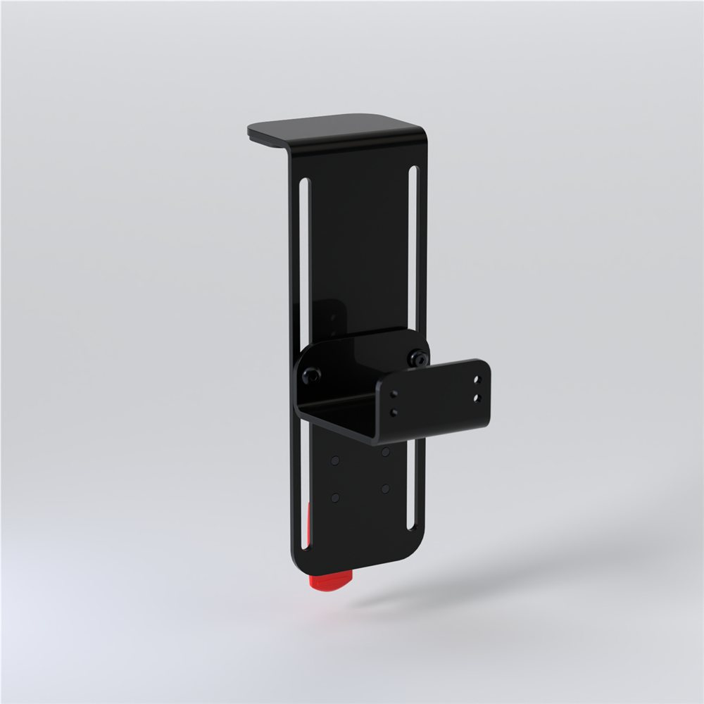
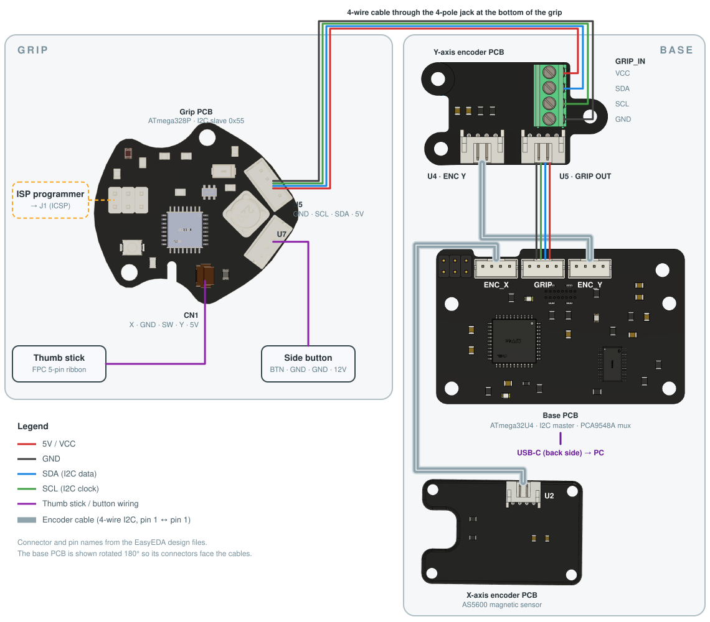
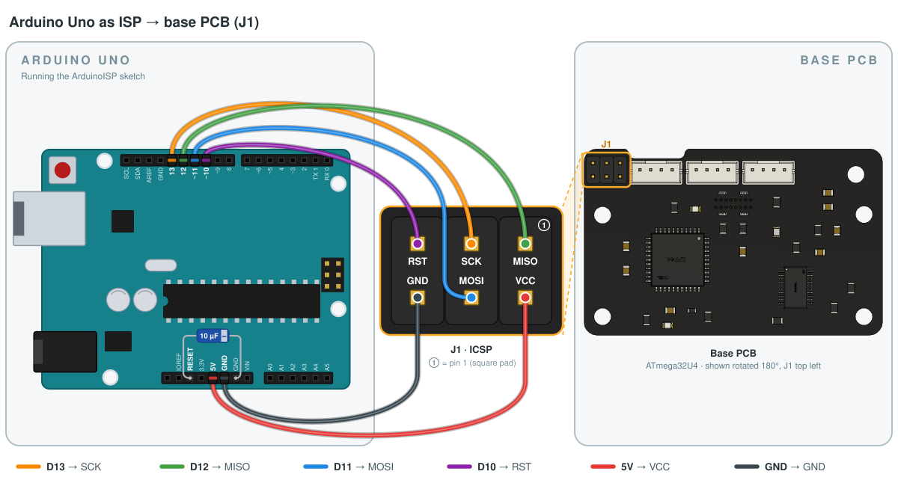
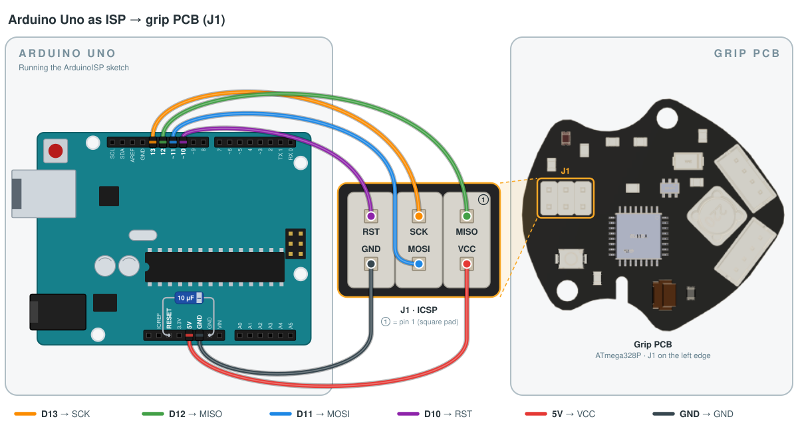
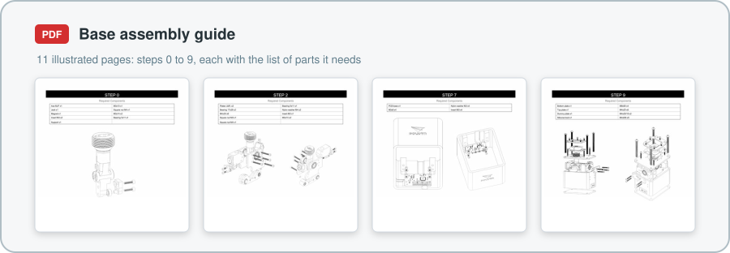

# Polysim Base — Build & User Manual

> **Manual version 1.0 — November 2026**
> Covers firmware **0.0.4** (base), the grip firmware, and configuration software **0.1** (Windows x64).


How to build, set up and use the **Polysim Base**, its **grip** and its **desk bracket**. The exploded views are in the [assembly guide (PDF)](Polysim_Base_Assembly_Guide.pdf), referred to here as *PDF steps 0–9*.

---

## Contents

1. [Overview](#1-overview)
2. [Tools and skills](#2-tools-and-skills)
3. [Bill of materials](#3-bill-of-materials)
4. [Manufacturing the parts](#4-manufacturing-the-parts)
5. [Electronics](#5-electronics)
6. [Programming the boards](#6-programming-the-boards)
7. [Assembly](#7-assembly)
8. [Configuration software](#8-configuration-software)
9. [Using Polysim in simulators](#9-using-polysim-in-simulators)
10. [Troubleshooting](#10-troubleshooting)
11. [Technical reference](#11-technical-reference)
12. [License and credits](#12-license-and-credits)

---

## 1. Overview

### 1.1 The modules

| Module | What it is | Files (in `hardware/`) |
|---|---|---|
| **Base** | Stainless-steel 2-axis gimbal with magnetic sensors and USB-C | `STEP/Base.step`, `STL/Base/`, `DXF/Base plates/` |
| **Grip G1 / G2** | Quick-release handle with a push button and a mini-stick (two body shapes) | `STEP/Grip G1.step`, `Grip G2.step`, `STL/Grip G1/`, `Grip G2/` |
| **Bracket** | Height-adjustable desk clamp | `STEP/Bracket.step`, `DXF/Bracket/` |

| Base | Grip | Bracket |
|---|---|---|
|  |  |  |

### 1.2 How it works

Plug the base in over USB-C and Windows sees a standard joystick, with no driver needed. A magnetic sensor reads each axis, and the grip connects through the base. The Polysim app handles calibration and firmware updates. Technical details are in [§11](#11-technical-reference).

### 1.3 Safety and disclaimer

This is a DIY project, provided as is: you build and use it at your own risk. Mind the sharp metal edges, the hot soldering iron and the compressed springs. Unplug the USB cable before you connect or disconnect the grip.

---

## 2. Tools and skills

You should be comfortable with 3D printing and mechanical assembly. You will need:

- an FDM 3D printer;
- a soldering iron with an insert tip, for the heat-set inserts;
- hex keys (2.5, 3 and 5 mm), a small flat screwdriver and circlip pliers;
- a Windows 10/11 PC, for the configuration software.

---

## 3. Bill of materials

The kit contains every part except the FDM prints. The boards come already programmed and the silicone boot is included.

<a href="https://polysim.fr/products/polysim-base"></a>

Prefer to source everything yourself? The full list of parts, hardware and indicative cost is in **[bill_of_material_source_yourself.md](bill_of_material_source_yourself.md)**.

---

## 4. Manufacturing the parts

### 4.1 FDM printed parts

Open [`hardware/3MF/Bambulab P2S PLA.3mf`](../hardware/3MF/) in Bambu Studio. All the parts are already oriented on 5 plates, with the print settings (PLA). On another printer, import this 3MF into your slicer to keep the orientation. The individual STL files are in `hardware/STL/`.

Then install the heat-set inserts with a soldering iron: 13 × M3 and 4 × M4 in the base, and 12 × M3 per grip.

### 4.2 Other parts

Everything else comes in the [kit](https://polysim.fr/products/polysim-base): metal plates, MJF shaft, silicone boot and programmed boards.

<details>
<summary><b>Sourcing these parts yourself (not recommended)</b></summary>

- **MJF/SLS parts** (PA12): main shaft, step-0 support and grip top plate, in `hardware/STL/SLS printing for extra strength/` and `Base/Others/SLS/`. Never print the shaft in FDM.
- **Base plates**: `hardware/DXF/Base plates/`, laser-cut from 5 mm stainless steel.
- **Bracket plates**: `hardware/DXF/Bracket/`, cut from 5 mm steel, then bent (see the PNG previews).
- **Silicone boot**: cast about 30 g of two-part silicone in the mould `hardware/STEP/Solicon_mold.step`.
- **Electronic boards**: the PCB files are not included in this repository.

Full list: [bill_of_material_source_yourself.md](bill_of_material_source_yourself.md).

</details>

---

## 5. Electronics



---

## 6. Programming the boards

> ✅ **Electronics kit from [polysim.fr](https://polysim.fr)?** The base and grip boards are delivered with their firmware already flashed. Skip this section and go to [§7](#7-assembly).

Each board is programmed once through its 6-pin ICSP header **J1**, here with an Arduino Uno as the programmer. After that, the base updates over USB.

### 6.1 Prepare the Arduino Uno

1. In the Arduino IDE, open **File → Examples → 11.ArduinoISP → ArduinoISP** and upload it to the Uno.
2. Add a **10 µF capacitor** between the Uno's **RESET** and **GND** (− leg on GND), so the Uno does not reset when programming starts.
3. Wire the Uno to J1 as shown below and select **Tools → Programmer → Arduino as ISP**. Keep the board's own USB cable unplugged: the Uno powers it.

A USBasp works too: connect its 6-pin cable with pin 1 on MISO.

### 6.2 Base board (ATmega32U4)



1. **Bootloader (once).** Select **Tools → Board → Arduino Micro**, then run **Tools → Burn Bootloader**. This writes the Caterina bootloader and the fuses (`lfuse 0xFF`, `hfuse 0xD8`, `efuse 0xCB`).
2. **Firmware over USB.** Remove the ISP wires and connect the base with a USB-C data cable. Open `software/firmware/base/` in PlatformIO and run **Upload**, or flash the prebuilt hex from `software/firmware/base/prebuilt/`:

   ```bash
   avrdude -p atmega32u4 -c avr109 -P COM5 -b 57600 -D -U flash:w:polysim_base_v0.0.4.hex:i
   ```

   Press the reset button (SW1), twice if needed, to start the bootloader for 8 s, and replace `COM5` with its port.
3. **Check.** `joy.cpl` (`Win + R`) lists **Polysim Base**. Later updates are done from the configuration software (§8.6).

### 6.3 Grip board (ATmega328P)



1. Open `software/firmware/grip/polysim_grip/polysim_grip.ino` in the Arduino IDE.
2. Select **Tools → Board → Arduino Nano** and **Processor → ATmega328P**.
3. Run **Tools → Burn Bootloader** once (it sets the 16 MHz crystal fuses), then **Sketch → Upload Using Programmer**.

---

## 7. Assembly

<a href="https://www.youtube.com/watch?v=ZJVehHBs4Xg"></a>

<a href="https://www.youtube.com/watch?v=2aSrMxbHL8U"></a>

### 7.1 General advice

- Install every heat-set insert before you start (§4.1).
- Do not over-tighten screws that go into plastic or inserts. Snug is enough.
- Check that each axis turns freely after every step. A tight bearing seat or a misaligned plate is much easier to fix early.
- Sort the hardware by step before you start. The PDF lists the parts for each step.

### 7.2 Base

<a href="Polysim_Base_Assembly_Guide.pdf"></a>

<a href="Polysim_Base_Assembly_Guide.pdf"></a>

### 7.3 Grip

Use `hardware/STEP/Grip G1.step` (or `Grip G2.step`) as the reference for part placement.

1. Install the 12 M3 inserts in the printed parts.
2. Program the grip board (§6.3).
3. Wire the push button to the `BTN` connector (§5) and the mini-stick to the FPC connector.
4. Mount the board on the PCB spacer (2 × M3×10), then install the spacer in the body.
5. Fit the push button and the mini-stick in the top plate, then close the top of the grip.
6. Mount the junction and the linker that carry the **male jack**, and connect the jack to the board's `GRIP_A` connector.
7. With the USB cable unplugged, insert the grip into the base and tighten the knurled ring.

### 7.4 Bracket

1. Mount the toggle clamp and assemble the two plates with the M6 screws. See `hardware/STEP/Bracket.step`.
2. Hook the bracket on the edge of the desk, lock it with the toggle clamp, then fix the base to it at the height you want using the slots.

### 7.5 Tuning

- **Centering force** comes from the two compression springs pushing on the cams. Stiffer or longer springs give a firmer return to centre.
- **Friction / damping** comes from the felt pads in the two brake assemblies (PDF steps 3 and 4). Start with the brake screws loose and tighten them gradually. Check that the stick still returns to centre on its own.
- **Recalibrate** (§8.4) after any mechanical change.

---

## 8. Configuration software


### 8.1 Requirements

- Windows 10 or 11, 64-bit. No separate .NET installation is needed.
- An Internet connection is optional. It is used to check for software and firmware updates.

### 8.2 Installation

1. Run `software/installer/Polysim_0_1.exe`.
2. The installer is not code-signed, so Windows SmartScreen may warn you. Click **More info → Run anyway** if you trust the source.
3. Accept the license and finish the installation.

### 8.3 Main screen

The main screen shows one tile per module with a USB status icon: **green** means detected, **red** means not detected. If several bases are connected, pick one from the drop-down list. Click **Configure** (spelled *Configue* in version 0.1) under a module to open its calibration screen.

- **Tools → Open windows calibration** opens the Windows game controller panel (`joy.cpl`).
- The **Throttle** tile is a placeholder; the throttle module is not available yet.

### 8.4 Calibrate the base

1. Click **Configure** under **Base**.
2. Click **Start calibration**.
3. **Step 1 (12 s):** move the stick slowly to **all its extremes**, including the corners, several times.
4. **Step 2 (6 s):** **let go of the stick** so it rests at its natural centre. Do not touch it.
5. **Step 3:** the calibration is written to the sensors and saved in the base EEPROM. It is restored automatically at every power-up.

The live position square should now cover the whole travel, with the dot centred at rest. Recalibrate after any mechanical change (springs, brakes, magnets).

### 8.5 Calibrate the grip

Open **Configure** under **Grip** and run the same three steps with the **mini-stick**.

> **Important.** After calibrating the grip, **unplug and replug the base's USB cable** to apply the new calibration. The grip calibration is stored in the **base**, so it stays with the base when you swap grips.

### 8.6 Firmware update

In the base calibration screen, the current firmware version is shown next to **Check update**. Click it. If a newer version is available on the Polysim update server, confirm, and the software downloads and flashes it. **Do not unplug the base during the update.**

### 8.7 Logs

The software writes a log to `%LOCALAPPDATA%\Polysim\Logs\logs.txt`. Include it with any bug report.

---

## 9. Using Polysim in simulators

No driver is needed: your simulator detects the base as a standard joystick named **Polysim Base**. Select it in the control settings and bind the stick, the grip mini-stick and the two grip buttons like any joystick. Inversion, response curves and dead zones are set in the simulator.

---

## 10. Troubleshooting

| Symptom | Likely cause | What to do |
|---|---|---|
| Nothing appears in `joy.cpl` | Charge-only USB cable, firmware not flashed, or a power problem | Use a USB data cable. If the board shows up as *Arduino Micro*, only the bootloader is present: flash the firmware (§6.2). |
| The software shows the base in red | The software only looks for the Polysim USB identity | Check that `joy.cpl` lists *Polysim Base*. Close other programs that may hold the COM port (serial monitors, PlatformIO). |
| The grip is shown in red | Jack not fully inserted, wiring error on `GRIP_A`, or grip not programmed | Unplug the USB cable, reseat the grip and tighten the ring. Check the VCC / GND / SDA / SCL order on both sides. Reprogram the grip (§6.3). |
| An axis does not move or jumps | Magnet missing, off-centre or too far from the sensor; encoder cable on the wrong connector | Check the magnet and encoder board mounting (PDF steps 0, 3 and 6) and the `ENC_X` / `ENC_Y` cables. Recalibrate. |
| The axis range is too small or off-centre | Calibration missing or outdated | Recalibrate (§8.4). Move to every corner in step 1 and let go in step 2. |
| A new grip calibration has no effect | It is applied when the base restarts | Unplug and replug the base. |
| The software is very slow to start | No Internet, or the update server does not respond | Wait (up to about 100 s) or connect to the Internet. |
| The firmware update failed and the base no longer responds | Interrupted download or flash | Reflash over USB with the bootloader (§6.2, step 2). If the bootloader is damaged, burn it again by ISP. |
| An axis is inverted in game | Different axis convention in the simulator | Invert the axis in the simulator. |

---

## 11. Technical reference

### 11.1 USB identity

| Field | Value |
|---|---|
| Product name | `Polysim Base` |
| Application VID / PID | `0x2342` / `0x803F` |
| Bootloader | Caterina (Arduino Micro), `avr109` protocol, 57600 baud, reset by a 1200-baud "touch" |
| MCU / clock | ATmega32U4, 16 MHz |
| Maximum firmware size | 28 672 bytes |

These values are in `software/firmware/base/boards/polysim_base.json`. The configuration software identifies a base by its VID/PID. If you distribute a modified firmware, use your own USB VID/PID and update the software accordingly.

### 11.2 I²C bus

| Multiplexer channel (PCA9548A @ `0x70`) | Device | Address |
|---|---|---|
| 0 | AS5600, Y axis | `0x36` |
| 1 | AS5600, X axis | `0x36` |
| 2 | Grip | `0x55` |

The AS5600 registers used are ZPOS (`0x01`), MPOS (`0x03`), RAW ANGLE (`0x0C`, during calibration) and ANGLE (`0x0E`, in use). The OTP *burn* command is **not** used: the AS5600 allows only three burns, so the calibration lives in the ATmega32U4 EEPROM and is rewritten to the sensor at boot.

### 11.3 Grip protocol (build your own grip)

A grip is any I²C slave at address **`0x55`** that implements these registers. The base writes the register number, then reads 1 or 2 bytes.

| Register | Content | Size |
|---|---|---|
| `0x01` | Main button: analog reading truncated to 8 bits. The base reads **pressed if > 100**, which suits a normally-closed contact with pull-up. | 1 byte |
| `0x02` | Stick click: analog reading truncated to 8 bits. The base reads **pressed if < 100**, which suits a normally-open contact with pull-up. | 1 byte |
| `0x03` | Mini-stick X, 0–1023 | 2 bytes, big-endian |
| `0x04` | Mini-stick Y, 0–1023 | 2 bytes, big-endian |

Grip connector: 4-pole jack carrying VCC (5 V), GND, SDA and SCL. The reference implementation is `software/firmware/grip/polysim_grip/polysim_grip.ino`. It uses pins A0 (button), A1 (click), A2/A3 (stick axes) and A4/A5 (SDA/SCL), and drives an LED on D2. To use more buttons, add registers on the grip and read them in `software/firmware/base/src/Grip.cpp`.

### 11.4 Serial protocol (base ⇄ software)

ASCII commands over the USB virtual serial port, terminated by `\n`:

```text
<P> <CMD> <VALUE>\n        P = J (base) or G (grip), CMD = 2 characters, VALUE = integer (0 if unused)
ACK <P> <CMD> <VALUE> <RESULT>\n
```

Example: `J VE 0` → `ACK J VE 0 0.0.4`. Malformed commands answer `ERROR`; unknown commands answer `UNKNOW`.

| Command | Action | Result |
|---|---|---|
| `J VE` | Firmware version | e.g. `0.0.4` |
| `J AX` / `J AY` | Calibrated angle X / Y | 0–4095 |
| `J RX` / `J RY` | Raw angle X / Y | 0–4095 |
| `J C1` / `J C2` | Read calibration min X / Y | integer |
| `J C3` / `J C4` | Read calibration max X / Y | integer |
| `J C5` / `J C6` | Write calibration min X / Y | `0` = OK |
| `J C7` / `J C8` | Write calibration max X / Y | `0` = OK |
| `J CL` | Clear calibration | `0` = OK |
| `J BX` / `J BY` | Save calibration X / Y to EEPROM | `0` = OK, `1` = read-back error |
| `G IC` | Grip connected? | `1` / `0` |
| `G RX` / `G RY` | Raw mini-stick value | 0–1023 |
| `G AX` / `G AY` | Calibrated mini-stick value | 0–1023 |
| `G MB` / `G JB` | Main button / stick click pressed | `1` / `0` |
| `G C1`…`G C4` | Read grip calibration min X, min Y, max X, max Y | integer |
| `G C5`…`G C8` | Write grip calibration min X, min Y, max X, max Y | `0` = OK |

### 11.5 EEPROM map (ATmega32U4)

All values are 16-bit integers, big-endian.

| Address | Content |
|---|---|
| `0x00–0x01` | Grip min X |
| `0x02–0x03` | Grip min Y |
| `0x04–0x05` | Grip max X |
| `0x06–0x07` | Grip max Y |
| `0x10–0x11` | AS5600 channel 0 (Y) min |
| `0x12–0x13` | AS5600 channel 1 (X) min |
| `0x20–0x21` | AS5600 channel 0 (Y) max |
| `0x22–0x23` | AS5600 channel 1 (X) max |

### 11.6 Building the firmware from source

```bash
cd software/firmware/base
pio run                # build → .pio/build/micro/firmware.hex
pio run -t upload      # flash over USB (Caterina bootloader)
```

The ArduinoJoystickLibrary is already included in `lib/`; there is nothing else to install. The version number is in `src/Version.h`.

---

## 12. License and credits

- Design files, documentation and Polysim firmware: **CC BY-NC-SA 4.0**. See [LICENSE](../LICENSE).
- Third-party components keep their own licenses. See [THIRD_PARTY_NOTICES.md](../THIRD_PARTY_NOTICES.md).
- Joystick HID support: [ArduinoJoystickLibrary](https://github.com/MHeironimus/ArduinoJoystickLibrary) by Matthew Heironimus (LGPL-3.0).

© 2024–2026 Polysim · [polysim.fr](https://polysim.fr)
